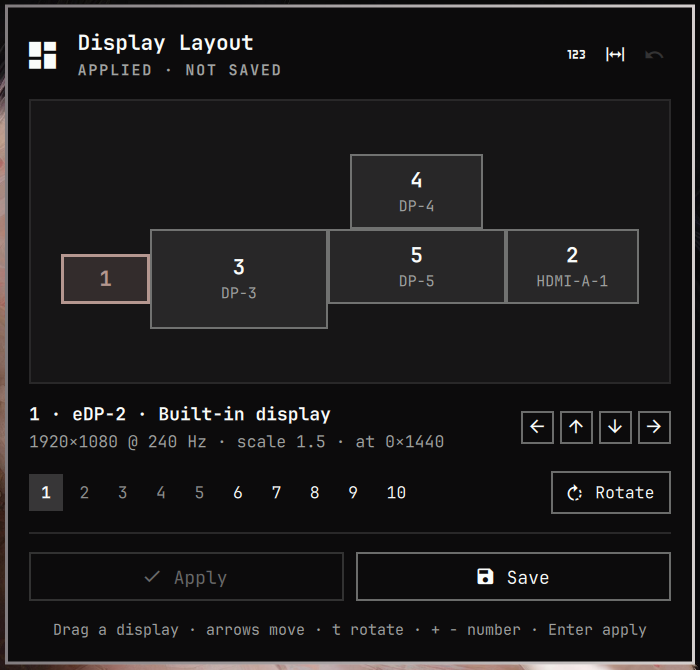

# Display Layout for Omarchy

Bar widget for arranging your displays. Every connected display is a tile; drag the tiles to where the screens stand on your desk, turn them, and choose which workspace number each one shows.



- **Drag and snap**: tiles snap to the edges and centres of their neighbours
- **Always a usable layout**: a tile dropped on top of another one, or away from all of them, slides to the nearest free edge. No gaps the pointer gets stuck at, no overlapping screens, and the layout always starts at `0x0`
- **Workspace numbers**: the number on a tile is the workspace that display shows, the same number as in the bar. Pick another one below the canvas; if a second display already has it, the two swap
- **Rotate**: turn a display by 90° per click, for portrait or upside-down screens
- **Numbers on the screens**: the `123` button shows each display's number on the real screen
- **Line up**: one click puts all displays in a row, in their current order
- **Apply**: try the layout right away, without touching any file
- **Save**: write it to `~/.config/hypr/monitors.lua` so it survives a restart

Keyboard: `1`–`9` and `0` select the display with that number, the arrow keys (or `h j k l`) move it to that side of the others, pressing the same arrow again slides it along the edge. `+` and `-` change its workspace number, `t` rotates it. `Enter` applies, `i` shows the numbers, `r` lines up, `u` undoes changes that are not applied yet.

## Install

```bash
omarchy plugin add https://github.com/Badr-Emil/omarchy-display-layout --enable
```

Requires Omarchy with the Lua Hyprland config (`~/.config/hypr/monitors.lua`). `hyprctl` is the only external command used and ships with Omarchy.

## What Save changes

Nothing is written until you press **Save**. Save then edits `~/.config/hypr/monitors.lua`:

- An existing `hl.monitor({ ... })` rule for a display only gets its `position` and `transform` replaced. Mode, scale and every other line of the file stay as they are
- A display without a rule gets one appended at the end, with its current mode and scale. External displays are matched by description (`desc:...`), because connector names such as `DP-3` change between plugs on docks; built-in panels and identical twin displays keep the connector name
- The workspace numbers go into a marked block at the end of the file, one `hl.workspace_rule({ workspace = "2", monitor = "...", default = true })` per display. The block is rewritten on every save; do not edit it by hand
- The previous file is kept next to it as `monitors.lua.display-layout-<time>.bak` (the newest five)
- If Hyprland reports a config error afterwards, the previous file is put back

**Apply** changes the running session only (`hyprctl eval`) and is undone by the next Hyprland reload. Hyprland restarts the bar on every display that moves, so the panel closes when you apply or save; open it again to continue.

A workspace moves to its new display together with its windows: if the left screen becomes number 2, everything that is open on workspace 2 shows up there.

Resolution and scale stay with Omarchy's own Display panel or your `monitors.lua`. Disabled and mirrored displays are not shown.

## Settings

- `hideWithOneDisplay` (default false): only show the widget while more than one display is connected
- `pinWorkspaces` (default true): choose the workspace number of each display. Turn it off to leave workspaces alone; tiles are then numbered in connection order and no workspace rule is written

## Privileges

Everything runs as your user. The panel calls `hyprctl monitors -j`, `hyprctl workspacerules -j` and `hyprctl eval`; `scripts/save-layout` writes `monitors.lua` and calls `hyprctl reload` and `hyprctl eval`. Nothing runs as root, nothing is downloaded, and no service is installed.

## Development

```bash
node --test tests/
```

## Remove

```bash
omarchy plugin remove io.github.badr-emil.display-layout
```

Saved layouts stay in `monitors.lua`. Delete the `monitors.lua.display-layout-*.bak` files in `~/.config/hypr/` if you no longer want the backups.
